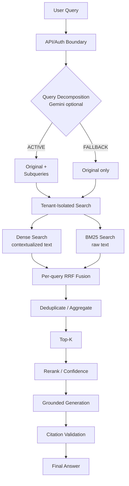

# Architecture

## V2.3.1 Pipeline

### Key Design Decisions
- **Contextualized vs. Canonical Text:** Dense embeddings use contextualized text (prepended with Document Title and Section) to improve semantic disambiguation. BM25 is strictly constrained to canonical raw text, as adding repeated metadata to the BM25 index degraded its performance.
- **Per-Query RRF Fusion:** When using query decomposition, each query branch (Original + Subqueries) independently assigns ranks (0 to K) to its retrieved hits before the RRF scores are globally aggregated by chunk ID. This prevents subquery hits from being unfairly penalized.
