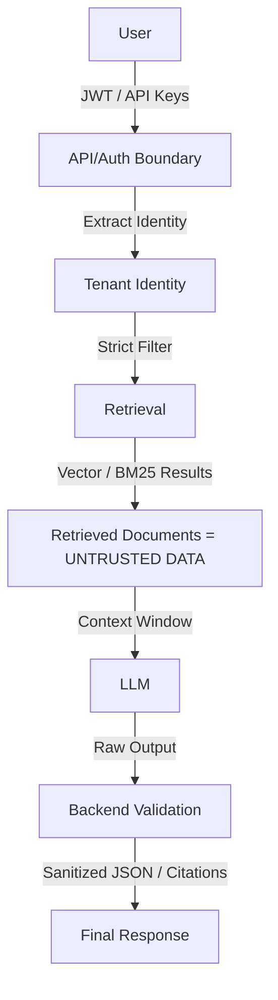

# Security & Threat Model

## Trust Boundaries

The system strictly enforces data isolation and sanitization across the following trust boundaries:

## Threats Mitigated
- **Tenant Data Leakage:** `tenant_id` is passed downward and enforced strictly at the database query level on every concurrent retrieval branch.
- **Subquery DoS:** The LLM could hypothetically generate unbounded JSON arrays of subqueries. The application imposes a hard `MAX_SUBQUERIES = 3` limit after parsing and deduplicating.
- **External Dependency Failure:** If the Gemini API experiences 429 errors or timeouts, the decomposition service degrades gracefully to the original user query, preventing a complete system outage.

## Threats Not Fully Solved
- **Prompt Injection:** The architecture reduces prompt-injection risk by treating retrieved content as untrusted data and enforcing citation validation and bounded execution, but no LLM-based system should be described as universally immune to prompt injection.
